<!-- Every picture here is drawn by scripts/build.mjs, and says in its alt text what it shows. -->

<a href="https://marcus.gg"><picture><source media="(prefers-color-scheme: dark)" srcset="https://raw.githubusercontent.com/Nerhh/Nerhh/main/assets/hero-dark.svg"></picture></a>

<picture><source media="(prefers-color-scheme: dark)" srcset="https://raw.githubusercontent.com/Nerhh/Nerhh/main/assets/year-dark.svg"></picture>

<a href="https://marcus.gg/umbra/"><picture><source media="(prefers-color-scheme: dark)" srcset="https://raw.githubusercontent.com/Nerhh/Nerhh/main/assets/umbra-dark.svg"></picture></a><a href="https://marcus.gg/vestra/"><picture><source media="(prefers-color-scheme: dark)" srcset="https://raw.githubusercontent.com/Nerhh/Nerhh/main/assets/vestra-dark.svg"></picture></a>
<a href="https://marcus.gg/dial/"><picture><source media="(prefers-color-scheme: dark)" srcset="https://raw.githubusercontent.com/Nerhh/Nerhh/main/assets/dial-dark.svg"></picture></a><a href="https://marcus.gg/tessera/"><picture><source media="(prefers-color-scheme: dark)" srcset="https://raw.githubusercontent.com/Nerhh/Nerhh/main/assets/tessera-dark.svg"></picture></a>
<a href="https://marcus.gg/admit/"><picture><source media="(prefers-color-scheme: dark)" srcset="https://raw.githubusercontent.com/Nerhh/Nerhh/main/assets/admit-dark.svg"></picture></a><a href="https://marcus.gg/tft-copilot/"><picture><source media="(prefers-color-scheme: dark)" srcset="https://raw.githubusercontent.com/Nerhh/Nerhh/main/assets/tft-copilot-dark.svg"></picture></a>

<picture><source media="(prefers-color-scheme: dark)" srcset="https://raw.githubusercontent.com/Nerhh/Nerhh/main/assets/about-dark.svg"></picture><picture><source media="(prefers-color-scheme: dark)" srcset="https://raw.githubusercontent.com/Nerhh/Nerhh/main/assets/languages-dark.svg"></picture>

<a href="https://marcus.gg"><picture><source media="(prefers-color-scheme: dark)" srcset="https://raw.githubusercontent.com/Nerhh/Nerhh/main/assets/link-site-dark.svg"></picture></a><a href="https://x.com/nerhhx"><picture><source media="(prefers-color-scheme: dark)" srcset="https://raw.githubusercontent.com/Nerhh/Nerhh/main/assets/link-x-dark.svg"></picture></a>

Drawn by <a href="scripts/build.mjs">one script with no dependencies</a>, in the same hand as <a href="https://marcus.gg">marcus.gg</a>: paper, ink, IBM Plex Mono and an 8×8 Bayer dither.

